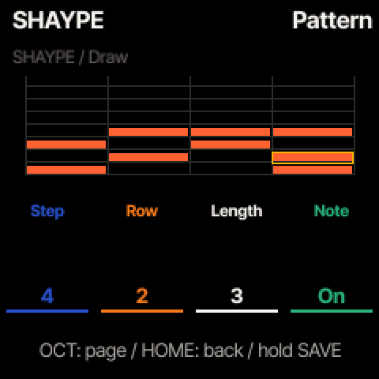

# ChoralRoot + SHAYPE — next test candidate

WaveLoop Shape Arp integrated with **ChoralRoot FM-1**, using its own chord/performance engine,
interface, note ownership and SAVE workflow. The public fork is
[ELI7VH/ChoralRootFM1](https://github.com/ELI7VH/ChoralRootFM1), based on upstream
[Quixotic7/ChoralRootFM1](https://github.com/Quixotic7/ChoralRootFM1) at
`ec9c54fdd7a0a544e8ec82bec196db745868f057`.

**Built and host/emulator tested; not installed on hardware. TEST remains on CoralFlower wlshape2.**

## Controls

1. Hold **ARP** to open PERF. Turn **SELECT** to **Pattern**.
2. Turn **K1** to pattern **13 / SHAYPE**.
3. Play a ChoralRoot chord. Tap ARP to switch Perform on/off as usual.

OCT− / OCT+ cycle the three SHAYPE pages. HOME closes the layer.

| Page | K1 | K2 | K3 | K4 |
| --- | --- | --- | --- | --- |
| Play | Starter preset | Division | Gate | Swing |
| Shape | Steps (1–64) | Direction | Wrap / octave | Root floor (Played or MIDI pitch) |
| Draw | Step | Chord row (1–8) | Length (1–64 steps) | Add / remove note |

K3 stretches an existing selected note. A pattern holds 62 notes; hidden steps return when STEPS is
lengthened again. Seven starters: SHAYPE, UP 4, UPDOWN, STABS, OCT RUN, PEDAL and DRONE.
UP, DOWN, PEND, Random, WYNDO and SHYFT retain the WaveLoop core's movement rules.
Turn K1 left past the first starter on Play to return to native pattern 12. The original twelve
patterns and all five performance modes remain available.

RATE/DIVISION includes straight, triplet (T) and dotted (D) values from 1/1 through 1/64,
plus ChoralRoot's original 2/1: 22 choices, slow to fast. Dotted lasts 1.5× and triplet 2/3×
the straight value. Original stored division IDs remain unchanged.

SHAYPE joins ChoralRoot's global clock and rate changes keep the melodic position. Its native
millisecond scheduler carries exact rational fractions using 1/96-beat units; no new sample clock,
audio buffer or MIDI-clock generator is added. ChoralRoot retains authority over MIDI clock,
chord gestures, bass, RAW output, latching and release. Native HOLD/LOCK apply; CoralFlower's
NOW/NOTE/CYCLE attachment controls are not part of this adapter. Selecting SHAYPE turns Pattern
retrigger off; SHAYPE itself always joins the global grid.

The native event pool and ownership limits still apply. An event without room for its matching
off is skipped. This does not promise unlimited polyphony or cure existing CPU limits.



## Save, migrate and restore

**Hold SAVE for global SAVE**, as in ChoralRoot. The pattern is manual session data, not an autosaved Option.
The 192-byte settings block stays its original size. Session v2 grows from 1024 to 1156 bytes inside its
existing A/B flash object; original field offsets remain intact and SHAYPE is appended at offset 1024.
There are no new flash sectors or widened write guards. Old sessions import their original state and
a default SHAYPE pattern. Keep a pre-upgrade backup: an upstream reader may reject the larger session.

Backup/restore adds **object 69**, the saved session. Reads remain read-only and therefore capture the
last global SAVE. The fork's CLI and browser backup library restore settings **1 before session 69**;
settings PUT deliberately clears an older session. Session restore validates its record and locks
saving until restart. Old clients/firmware may skip object 69, so use this fork's restore tools.

CoralFlower and ChoralRoot song/loop/session formats are different. Installation is a separate next step,
after a fresh TEST backup and stopped confirmation. If the native installer refuses the source firmware,
follow its official-V15 bridge instructions; do not force through the refusal.

## Developer integration and checks

- `arp_shape.c`, `cr_shape.h`: unchanged donor core and adapter data/API.
- `cr_engine.c/.h`: Pattern 13, polyphonic events through the native registry, rational divisions and phase joins.
- `cr_ui.c`, `cr_screen.h`, `cr_draw.c`, `cr_out.c`: native pages, input, snapshot and themed grid. Playhead changes redraw the grid band only.
- `cr_settings.c/.h`: append-only session extension, defaults/import/SAVE/revert.
- `cr_backup.c`, `tools/fm1_install.py`, `web/fm1backup.js`: session backup/validation and restore order.

```sh
python3 -c 'import sys; sys.path.insert(0,"tools"); import build; build.generate()'
sh tools/test_shape.sh
./build.sh --release 0.27-wlshape1
```

The normal build prerequisites are in BUILDING.md. Both standard and one-core packages build.
Core parity, 2800 existing engine checks, 483 loop checks, 296 settings checks, 236 backup checks,
2012 focused SHAYPE checks under full UBSan, and 13 UI/save/restore/redraw checks pass.
The CLI installer and browser backup tests pass, including session-after-settings restore order.
Native emulator input renders the pages and produces audio. Target XIP/RAM/POOL/ISR guards pass.
Remote CI and physical sound/timing/CPU acceptance are separate; no hardware installation or listening is claimed.

The unchanged WaveLoop core/fixtures are pinned in [SHAYPE-PROVENANCE.json](SHAYPE-PROVENANCE.json).
No upstream PR or author message has been sent; this is an opt-in fork for review/reuse.

SHAYPE design and adapter: **Elijah Lucian / Lucian Labs, WaveLoop**.
ChoralRoot: **Quixotic7 and contributors**, after their monome-grid choralroot engine.
Felucca platform/engines: **Leo Kuroshita / Hügelton Instruments**. Other sound engines, fonts
and dependencies retain their upstream credits in README.md and LICENSING.md. GPL-3.0-only;
all original headers are retained. This is the ChoralRoot adapter; CoralFlower is a separate fork.
