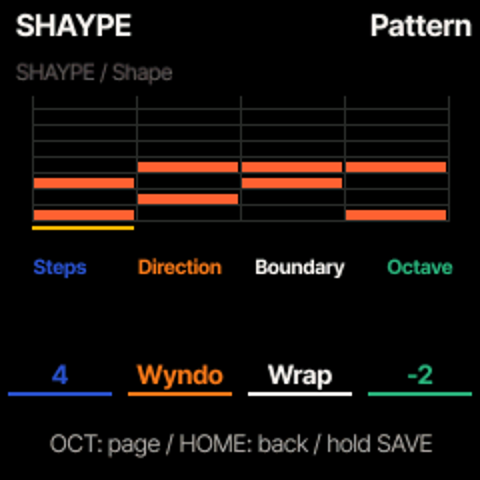
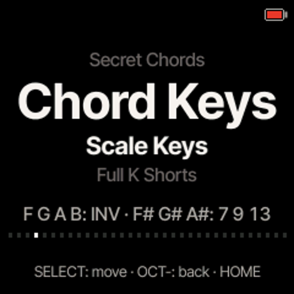

# ChoralRoot + SHAYPE

WaveLoop Shape Arp integrated with **ChoralRoot FM-1**, using its own chord/performance engine,
interface, note ownership and SAVE workflow. The public fork is
[ELI7VH/ChoralRootFM1](https://github.com/ELI7VH/ChoralRootFM1), based on upstream
[Quixotic7/ChoralRootFM1](https://github.com/Quixotic7/ChoralRootFM1) at
`ec9c54fdd7a0a544e8ec82bec196db745868f057`.

**Hardware-tested on TEST as ChoralRoot 0.27-wlshape3, with SHAYPE Pattern 13 and Scale Keys. TEST returned to CoralFlower 0.6.1-wlshape3 on 2026-10-31.**

## Controls

1. Hold **ARP** to open PERF. Turn **SELECT** to **Pattern**.
2. Turn **K1** to pattern **13 / SHAYPE**.
3. Play a ChoralRoot chord. Tap ARP to switch Perform on/off as usual.

OCT− / OCT+ cycle the three SHAYPE pages. HOME closes the layer.

| Page | K1 | K2 | K3 | K4 |
| --- | --- | --- | --- | --- |
| Play | Starter preset | Division | Gate | Swing |
| Shape | Steps (1–64) | Direction | Wrap / octave | Octave (−2…+2) |
| Draw | Step | Chord row (1–8) | Length (1–64 steps) | Add / remove note |

K3 stretches an existing selected note. A pattern holds 62 notes; hidden steps return when STEPS is
lengthened again. Seven starters: SHAYPE, UP 4, UPDOWN, STABS, OCT RUN, PEDAL and DRONE.
UP, DOWN, PEND, Random, WYNDO and SHYFT retain the WaveLoop core's movement rules.
Turn K1 left past the first starter on Play to return to native pattern 12. The original twelve
patterns and all five performance modes remain available.

RATE/DIVISION includes straight, triplet (T) and dotted (D) values from 1/1 through 1/64,
plus ChoralRoot's original 2/1: 22 choices, slow to fast. Dotted lasts 1.5× and triplet 2/3×
the straight value. Original stored division IDs remain unchanged.

SHAYPE joins ChoralRoot's global clock and rate changes keep the melodic position. Its native
millisecond scheduler carries exact rational fractions using 1/96-beat units; no new sample clock,
audio buffer or MIDI-clock generator is added. ChoralRoot retains authority over MIDI clock,
chord gestures, bass, RAW output, latching and release. Native HOLD/LOCK apply; CoralFlower's
NOW/NOTE/CYCLE attachment controls are not part of this adapter. Selecting SHAYPE turns Pattern
retrigger off; SHAYPE itself always joins the global grid.

The native event pool and ownership limits still apply. An event without room for its matching
off is skipped. This does not promise unlimited polyphony or cure existing CPU limits.


## Save, migrate and restore

**Hold SAVE for global SAVE**, as in ChoralRoot. The pattern is manual session data, not an autosaved Option.
The 192-byte settings block stays its original size. Session v2 grows from 1024 to 1156 bytes inside its
existing A/B flash object; original field offsets remain intact and SHAYPE is appended at offset 1024.
There are no new flash sectors or widened write guards. Old sessions import their original state and
a default SHAYPE pattern. Keep a pre-upgrade backup: an upstream reader may reject the larger session.

Backup/restore adds **object 69**, the saved session. Reads remain read-only and therefore capture the
last global SAVE. The fork's CLI and browser backup library restore settings **1 before session 69**;
settings PUT deliberately clears an older session. Session restore validates its record and locks
saving until restart. Old clients/firmware may skip object 69, so use this fork's restore tools.

CoralFlower and ChoralRoot song/loop/session formats are different. Keep a fresh backup and stop
playback before switching families. If the native installer refuses the source firmware,
follow its official-V15 bridge instructions; do not force through the refusal.

## Developer integration and checks

- `arp_shape.c`, `cr_shape.h`: unchanged donor core and adapter data/API.
- `cr_engine.c/.h`: Pattern 13, polyphonic events through the native registry, rational divisions and phase joins.
- `cr_ui.c`, `cr_screen.h`, `cr_draw.c`, `cr_out.c`: native pages, input, snapshot and themed grid. Playhead changes redraw the grid band only.
- `cr_settings.c/.h`: append-only session extension, defaults/import/SAVE/revert.
- `cr_backup.c`, `tools/fm1_install.py`, `web/fm1backup.js`: session backup/validation and restore order.

```sh
python3 -c 'import sys; sys.path.insert(0,"tools"); import build; build.generate()'
sh tools/test_shape.sh
./build.sh --release 0.27-wlshape1
```

The normal build prerequisites are in BUILDING.md. Both standard and one-core packages build.
Core parity, 2800 existing engine checks, 483 loop checks, 296 settings checks, 236 backup checks,
2012 focused SHAYPE checks under full UBSan, and 13 UI/save/restore/redraw checks pass.
The CLI installer and browser backup tests pass, including session-after-settings restore order.
Native emulator input renders the pages and produces audio. Target XIP/RAM/POOL/ISR guards pass.
Remote CI and physical listening/broad CPU acceptance remain separate from the limited target check below.

The unchanged WaveLoop core/fixtures are pinned in [SHAYPE-PROVENANCE.json](SHAYPE-PROVENANCE.json).
No upstream PR or author message has been sent; this is an opt-in fork for review/reuse.

SHAYPE design and adapter: **Elijah Lucian / Lucian Labs, WaveLoop**.
ChoralRoot: **Quixotic7 and contributors**, after their monome-grid choralroot engine.
Felucca platform/engines: **Leo Kuroshita / Hügelton Instruments**. Other sound engines, fonts
and dependencies retain their upstream credits in README.md and LICENSING.md. GPL-3.0-only;
all original headers are retained. This is the ChoralRoot adapter; CoralFlower is a separate fork.

## TEST installation — 2026-10-30

Installed source `dc018a0`, package SHA256
`6af5ee45c85396c0aac428ee6b3bb8338c579b20b3f59952ad2231f77cb083e3`, after explicit stopped confirmation.
A fresh 27-object CoralFlower wlshape3 backup, source/package and receipt were archived before switching.
Used the hash-verified official V15 bridge, then the native ChoralRoot installer; no force override.
Reboot and full version/unit identity verified over the editor protocol. SHOW remains Switch Blade chain14;
GHOUL is unchanged.

The first boot contained an unrecognized legacy settings record; ChoralRoot used its native boot defaults.
That record is preserved in the first-boot backup. Selected Pattern 13 and enabled Perform using a native
validated settings record based on those boot defaults. A temporary MIDI Keys channel drove the actual
key/chord engine for four seconds: 28 chord note-ons, 12 polyphonic pairs, no note-ons after release grace.
The temporary input mapping was removed. Selected settings read back exactly; every other listed object
matched the first-boot backup. The native saved session was empty and was not populated automatically.
Hold SAVE for global SAVE after drawing/editing SHAYPE.

This verifies installation, settings persistence and limited real-target MIDI behavior. Physical listening,
external clock/rate acceptance and broad CPU/headroom testing remain with the user.

## Octave control — wlshape2

Shape-page K4 is now **Octave −2…+2**, replacing the pitch-floor ROOT control. Each detent shifts
all generated SHAYPE notes by 12 semitones; changes affect upcoming attacks without restarting the
pattern. Notes already sounding finish normally. Out-of-range MIDI pitches are skipped.

The previously reserved byte in the 132-byte SHAYPE data holds the signed octave. Older sessions
read as octave0; their former ROOT byte is retained for layout compatibility and is ignored. Session
v2 remains1156 bytes, settings remain192 bytes, with no new flash sectors or altered save workflow.
Use native global SAVE to persist it. Older firmware ignores the added octave value when downgrading.

Host validation: donor parity, 2800 native engine,483 loop,296 settings,236 backup,2030 SHAYPE full
UBSan and16 UI/save/restore checks pass. Includes exact −24/−12/0/+12/+24 pitch offsets, edits during
a held chord, MIDI bounds, label/limits and session save/revert. Build/hardware status follows the
current installation receipt. Installed on TEST after stopped/discard confirmation and a fresh backup;
all stored objects read back byte-identical. Target MIDI octave−1:50/53/57, octave0:62/65/69,
octave+1:74/77/81, exact12semitone shifts. Temporary test settings/session removed; original data
read back exactly. Physical listening remains with the user.



## Scale Keys — wlshape3

Options → **Chord Keys → Scale Keys** selects the new layout. Classic and FM-1 remain available.
Root keys from C4 upward automatically play chords from the selected tonic and Major/Minor scale.
The low controls are silent on their own: hold a root to hear their changes.

| Low keys | Action |
| --- | --- |
| F / G / A / B | Select root position / first / second / third inversion |
| F♯ | Hold to add the scale's seventh |
| G♯ | Hold to add the scale's ninth |
| B♭ (A♯) | Hold to add the scale's thirteenth |

The black keys combine: 7+9, 7+13, 9+13 or all three. Releasing one removes only its extension;
releasing the white key keeps the selected inversion. With a plain triad, third inversion is an
octave-up voicing; with a seventh chord it is the third inversion. Scale choice still uses the
native KEY layer. Accidentals and alternate mappings are future work.

The layout selection uses a formerly unused bit in the native settings byte; settings remain192
bytes and session remains1156bytes. Native Options persistence applies to the layout; native global
SAVE persists musical state such as inversion/pattern edits. Older firmware does not understand
the Scale Keys flag and may reset that byte's RAW/MIDI Keys choices when downgrading; retain a backup.
The low-key extension set is momentary; use Classic/FM-1 for the original chord-type latch behavior.

Validation: 10,759 Scale Keys engine checks under full UBSan cover every tonic, Major/Minor degree,
all extension combinations, four inversions, clean releases and SHAYPE phase retention. Existing
2800engine/483loop/296settings/2030SHAYPE/236backup checks pass;23native UI/save/restore checks pass.
Standard target build guards pass. Native emulator option/control screenshots and sound/release
checks pass. Installed/reboot/readback verified on TEST as wlshape3, source81d9507, after the approved stopped/discard
workflow and fresh wlshape2 backup. All original objects matched after firmware installation.
Real target MIDI verified automatic Cmajor/Cminor, all four inversion positions, seven extension sets
with independent removal, SHAYPE walking the six-note extended chord, and clean root/control release.
Scale Keys is selected for the user; temporary MIDI Keys routing and test tonalities removed.
Selected settings read back exactly; every other object remains identical to the saved original.
Physical listening and broad CPU/headroom acceptance remain separate. SHOW/GHOUL unchanged.



## TEST returned to CoralFlower — 2026-10-31

The user finished the ChoralRoot trial. Its current stored objects, matching firmware/source and receipt
were archived locally before returning TEST to CoralFlower wlshape3 and restoring that firmware's earlier
state. This does not change the tested ChoralRoot feature status above. Future installs need a fresh
backup and stopped confirmation. SHOW/GHOUL remain untouched.
